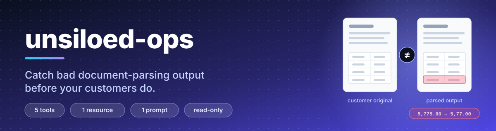
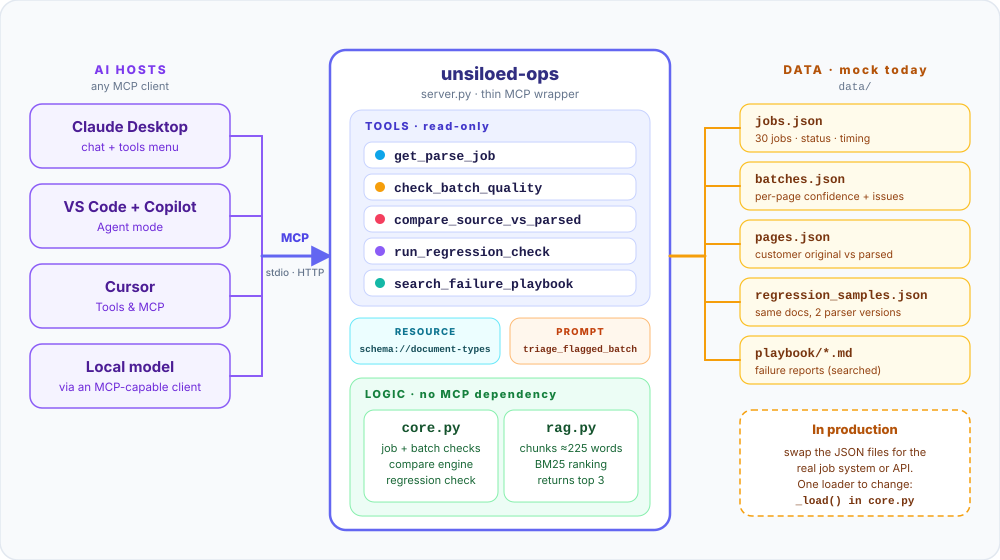
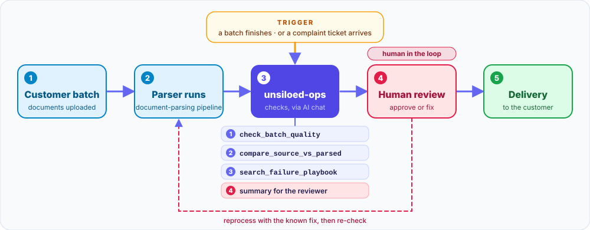
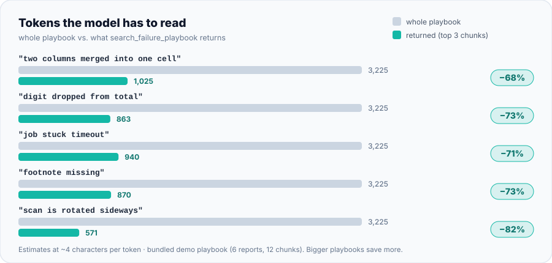
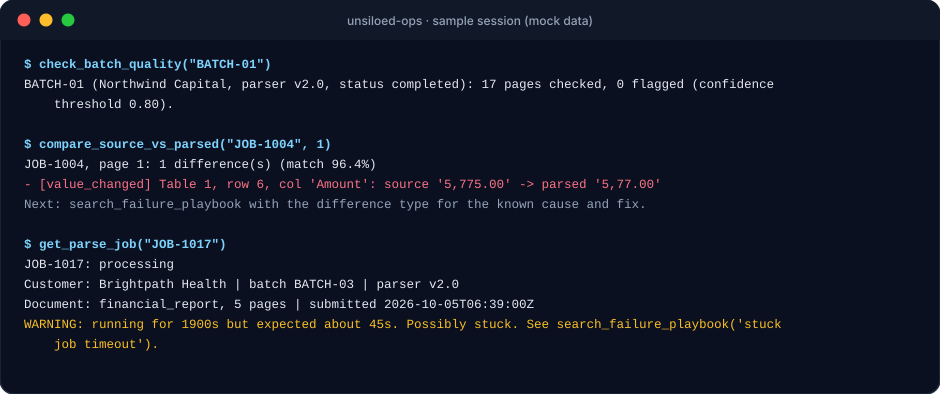

<div align="center">



<br>


<h3>An AI-chat toolkit that finds the parsing mistakes nobody notices, <em>before</em> the customer does.</h3>

<p>
<a href="#-about-the-company">🏢 Company</a> ·
<a href="#-the-problem">🎯 Problem</a> ·
<a href="#-what-it-does">✨ Tools</a> ·
<a href="#-architecture">🧩 Architecture</a> ·
<a href="#-workflow">🔄 Workflow</a> ·
<a href="#-hosts">🔌 Hosts</a> ·
<a href="#-context">🧠 Context</a> ·
<a href="#-quick-start">🚀 Quick start</a> ·
<a href="#-demo">🎬 Demo</a>
</p>

</div>

---

## 🏢 About the company

**Unsiloed AI** is a small San Francisco startup (Y Combinator, F2025) that builds document-parsing technology for AI teams.

| About | Details |
|---|---|
| 🧰 **What they do** | Turn complex documents (text, tables, images and charts mixed together) into clean, structured data that AI workflows can use. |
| 👥 **Who uses it** | AI and engineering teams building document pipelines over invoices, bank statements, financial reports, scanned forms and research papers. |
| 🔥 **The pain they solve** | Teams often spend months on document workflows, and generic LLM parsers and OCR tend to fail on documents that mix content types. |
| 🎯 **Who this server is for** | Unsiloed's **own** engineering and support team. It is an internal tool, not something customers use. |

> [!NOTE]
> This project is modelled on Unsiloed AI's **public description** only. It is **not affiliated with or endorsed by Unsiloed AI**, and all data in this repo is **mock data** generated by `generate_data.py`. The failure modes below are informed assumptions, not facts about their systems.

## 🎯 The problem

A parser's worst failures are the **quiet** ones. A dropped digit, a lost footnote or two columns read in the wrong order can come back with *high confidence*, flow straight into a customer's pipeline, and only surface days later as a support ticket.

`unsiloed-ops` moves that discovery earlier, to the moment a batch finishes. Its key idea: **compare the customer's original page with the parsed output** instead of trusting the parser's own confidence.

| | Problem the team faces | What it looks like | Caught by |
|:-:|---|---|---|
| 🟡 | A job is stuck or failed | "Is my job done?" tickets, batches that never finish | `get_parse_job` |
| 🟠 | The parser is unsure | Low confidence, known issue flags, missing required fields | `check_batch_quality` |
| 🔴 | The parser is **confidently wrong** | Dropped digit, missing row, merged cells, lost chart or footnote, shuffled text | `compare_source_vs_parsed` |
| 🟣 | A parser update breaks old documents | Quality drops on layouts that used to work | `run_regression_check` |
| 🔵 | "We have seen this before" | Engineers re-debug the same failure | `search_failure_playbook` |

## ✨ What it does

**5 tools · 1 resource · 1 prompt.** Every tool is **read-only**: nothing can modify jobs or customer data.

| Tool | Answers | Why it exists |
|---|---|---|
| 🟦 `get_parse_job(job_id)` | "Is job X done, failed, or stuck?" | Replaces the constant status questions. Warns when a job runs 3x longer than expected for its type and size. |
| 🟧 `check_batch_quality(batch_id, threshold)` | "Which pages in this batch look risky?" | The **proactive** tool. Scans for low confidence, known issue types and missing required fields *before* delivery. |
| 🟥 `compare_source_vs_parsed(job_id, page)` | "What exactly changed between the original and our output?" | The **key** tool. Finds changed values, missing rows, merged cells, dropped charts and footnotes, reordered text. Returns only the differing snippets, never whole pages, because customer data is sensitive. |
| 🟪 `run_regression_check(old, new)` | "Did the new parser version make anything worse?" | Compares two versions on saved sample documents and lists what regressed or improved. |
| 🟩 `search_failure_playbook(question)` | "Have we seen this before? What fixed it?" | Retrieval over past failure reports. Returns only the 3 best chunks, so the model never reads the whole playbook. |

| Type | Name | Why it exists |
|---|---|---|
| 📚 Resource | `schema://document-types` | Reference data (document types, required output fields, expected speed) a client can load as context. |
| 📝 Prompt | `triage_flagged_batch(batch_id)` | A reusable step-by-step triage that ends in a summary for a **human** reviewer. |

## 🧩 Architecture



| Layer | File | Responsibility |
|---|---|---|
| 🔌 **Protocol** | `server.py` | Thin MCP wrapper. Exposes the tools, resource and prompt. Works with MCP SDK v2, v1 and standalone `fastmcp`. |
| 🧠 **Logic** | `core.py` | All tool behaviour and the page-comparison engine. No MCP dependency, so it is fully testable. |
| 🔎 **Retrieval** | `rag.py` | Chunking, BM25 ranking and token estimates. Pure Python, works offline, no API key. |
| 🗄️ **Data** | `data/` | Mock jobs, batches, original-vs-parsed pages, regression samples and the failure playbook. |

**Design choices**

- 🔒 **Read-only by design.** No tool writes anything.
- 🏷️ **Plain, verb-first names and flat arguments** (strings, one int, one float), so less capable models call tools correctly.
- 🧭 **Descriptions say *when* to use a tool** and list valid ID formats (`JOB-1001` to `JOB-1030`).
- 🩹 **Helpful errors**, e.g. "Job IDs look like JOB-1001 to JOB-1030", never stack traces.
- ➡️ **"Next:" hints** at the end of results nudge the model toward the logical next tool.
- 🪶 **Token-lean output:** short plain text, capped lists, snippets instead of pages.

## 🔄 Workflow



| Stage | Details |
|---|---|
| ⚡ **Trigger** | A batch finishes processing, or a support ticket says "your output looks wrong". |
| ⬅️ **Before it** | The parsing pipeline produces the batch. |
| ➡️ **After it** | A human reviewer fixes or approves, then the batch is delivered. If something is wrong, the batch is reprocessed with the known fix and checked again. |
| 🧑 **Human in the loop** | **Yes.** The server only reads and reports. The triage prompt ends with a summary for a person and tells the model **not** to contact the customer. |
| 🔌 **Transport** | **stdio today**: simplest for one person on one machine. **HTTP for a team**: one shared server, one set of credentials, one audit log (add authentication in front before real use). The same code runs either way. |

## 🔌 Hosts

The server speaks standard MCP, so it is not tied to one assistant. Configs are provided for these hosts:

| Host | Config file | Server key | Tools | Resource and prompt | Picks the right tool |
|---|---|:-:|:-:|:-:|:-:|
| 🟣 **Claude Desktop** | `claude_desktop_config.json` | `mcpServers` | 🔲 | 🔲 | 🔲 |
| 🔵 **VS Code + Copilot** (Agent mode) | `.vscode/mcp.json` | `servers` | 🔲 | 🔲 | 🔲 |
| ⚫ **Cursor** | `.cursor/mcp.json` or `~/.cursor/mcp.json` | `mcpServers` | 🔲 | 🔲 | 🔲 |
| 🟠 **Local model** (e.g. Ollama) | needs a client that can speak MCP to the model | n/a | 🔲 | 🔲 | 🔲 |

<sub>🔲 = to record after testing on your machine. Hosts differ: some surface only tools, not resources or prompts, and smaller models may pick the wrong tool. Update this table with what you observe.</sub>

**Built so that smaller models cope too:** plain tool names, flat arguments, "use this when…" descriptions, valid-ID hints in every description, helpful error messages, and a "Next:" hint after each result.

<details>
<summary><b>⚙️ Host configuration (click to expand)</b></summary>

<br>

Use **absolute paths**, and make `command` the Python that has `mcp` installed (`python -c "import sys; print(sys.executable)"` prints it). On Windows, forward slashes (`C:/path/...`) avoid JSON escaping problems. **Fully restart** the host after editing its config.

**Claude Desktop** (Settings → Developer → Edit Config) and **Cursor** (`.cursor/mcp.json`):

```json
{
  "mcpServers": {
    "unsiloed-ops": {
      "command": "/ABSOLUTE/PATH/TO/python",
      "args": ["/ABSOLUTE/PATH/TO/unsiloed-mcp/server.py"]
    }
  }
}
```

**VS Code** (`.vscode/mcp.json`, note the key is `servers`). Switch Copilot Chat to **Agent** mode, since MCP tools only run there:

```json
{
  "servers": {
    "unsiloed-ops": {
      "type": "stdio",
      "command": "/ABSOLUTE/PATH/TO/python",
      "args": ["/ABSOLUTE/PATH/TO/unsiloed-mcp/server.py"]
    }
  }
}
```

</details>

## 🧠 Context

`search_failure_playbook` indexes the documents in `data/playbook/` and returns **only the relevant passages**, so the model never reads the whole playbook.

| Setting | Detail |
|---|---|
| ✂️ **Chunk size** | ~225 words (≈ 300 tokens) with 40 words of overlap, so sentences that straddle a boundary stay findable. |
| 🔎 **Ranking** | BM25 in pure Python: no API key, no model download, works offline, easy to explain. Embeddings are the upgrade path for fuzzier questions. |
| 📦 **Chunks returned** | The top **3**, plus a footer showing tokens returned versus the full playbook. |
| 📚 **Bundled corpus** | 6 failure reports → 12 chunks. |



The bundled playbook is small. In a real playbook with hundreds of reports, the returned size stays about the same while the full size grows, so the saving gets **larger**. The other tools are lean too: the comparison returns only differing snippets (capped at 10), never whole pages.

<details>
<summary><b>📥 Adding your own documents</b></summary>

<br>

1. Put files in `data/playbook/`. Markdown (`.md`) works out of the box.
2. Name them descriptively (`ocr_digit_errors.md`, not `doc3.md`): filename words are indexed too.
3. **Restart the server.** The index is built on the first search and cached.
4. Run `python tests/test_tools.py`. A new document on a similar topic may legitimately change which report ranks first, so one or two retrieval tests may need updating.

Other formats (`.txt`, `.pdf`, `.docx`, …) need a text-extraction step added to the file loop in `rag.py`. PDFs without a text layer (scans) need OCR first.

</details>

## 🚀 Quick start

Requires **Python 3.10+**.

```bash
python -m pip install -r requirements.txt   # installs the MCP SDK (v1 or v2)
python tests/test_tools.py                  # 17 tests of the tool logic, no MCP needed
python server.py                            # stdio: starts and waits silently for a client
python server.py --transport http           # HTTP on 127.0.0.1:8000 (MCP_HOST / MCP_PORT to change)
```

Use `python -m pip` so the library installs into the same Python that runs the server. `generate_data.py` regenerates the mock data deterministically (it is already committed).

## 🎬 Demo

Real output from the bundled mock data. Note the first step: **nothing is flagged** for `BATCH-01`, yet the comparison finds a dropped digit. The parser was 97% confident on that page and still wrong.



**Try these in your host:**

> 💬 *"Review BATCH-03 before delivery."*
> 💬 *"Is JOB-1017 stuck?"*
> 💬 *"Compare JOB-1004 page 1 with the original."*
> 💬 *"Did v2.0 make anything worse than v1.4?"*
> 💬 *"What causes merged table cells?"*
> 💬 Or run the **`triage_flagged_batch`** prompt.

<!--
📸 Add real screenshots of your host sessions here, for example:
 
-->

## 🧪 Testing and status

| Check | Result |
|---|---|
| ✅ **Verified** | Tool logic (17 passing tests), retrieval ranking, and the server's registration of 5 tools + 1 resource + 1 prompt against stand-ins for MCP SDK v2, SDK v1 and standalone `fastmcp`, in both stdio and HTTP modes. |
| 🔲 **Not yet verified by the author** | End-to-end runs inside each real host (Claude Desktop, VS Code, Cursor) and the HTTP transport on a real SDK. If a host misbehaves, see Troubleshooting below. |

## 🔁 Using real data

Today all data is read from JSON files through a **single loader** (`_load` in `core.py`), so replacing them is the natural integration point.

- **Real jobs and batches:** point the loader at a real job system or API. The tool logic does not change.
- **Real documents for the comparison:** take a public document's text layer as the ground truth, OCR a rendering of the same page as the "parsed" version, and convert both into the page format used by `data/pages.json` (`blocks`, `tables`, `charts`, `footnotes`). OCR makes genuine mistakes (dropped digits, merged columns), so the comparison runs unchanged. Use public documents only.
- **In production,** the "source" side needs a trustworthy ground truth (labelled samples or a second extraction pass), and customer documents need proper access control and privacy handling.

## 🚧 Limitations

- **Mock data only.** It demonstrates the design, not real parsing accuracy.
- **Pre-recorded quality data.** Confidence, issue type and missing-field values in the mock batches are generated, not computed from real parser output.
- **The comparison needs ground truth.** Only 8 mock pages have an original/parsed pair.
- **Brand-new document types** can fail without warning; only low confidence hints at them.
- **`check_batch_quality` covers completed jobs only.** Use `get_parse_job` for stuck or queued ones.
- **Token counts are estimates** (about 4 characters per token), not a real tokenizer.
- **No authentication** is included. Add it before exposing the HTTP transport to a team.

## 🔭 Roadmap

- [ ] Swap BM25 for embeddings to handle fuzzier questions
- [ ] Compute page-quality records from real parser output instead of pre-recorded values
- [ ] OCR-based importer that turns a folder of public PDFs into original/parsed pairs
- [ ] Support `.txt`, `.pdf` and `.docx` in the playbook loader
- [ ] Authentication and per-user audit logging for the HTTP transport

## 📁 Project layout

<details>
<summary><b>Show file tree</b></summary>

```text
unsiloed-mcp/
├── server.py              MCP wrapper: 5 tools, 1 resource, 1 prompt
├── core.py                all tool logic + comparison engine (no MCP dependency)
├── rag.py                 chunking, BM25 search, token estimates
├── generate_data.py       deterministic mock-data generator
├── requirements.txt       mcp[cli]
├── assets/                README graphics (SVG)
├── data/
│   ├── jobs.json          30 mock jobs
│   ├── batches.json       5 batches with per-page quality records
│   ├── pages.json         original vs parsed page pairs (planted errors)
│   ├── regression_samples.json   same documents, two parser versions
│   ├── document_types.json       types, required fields, expected speed
│   └── playbook/          6 failure reports searched by the retrieval tool
└── tests/test_tools.py    17 plain-Python tests
```

</details>

## 🩺 Troubleshooting

<details>
<summary><b>Click to expand</b></summary>

<br>

- **`No module named mcp.server.fastmcp`:** you have MCP SDK 2.x, where `FastMCP` was renamed `MCPServer` and host/port moved from the constructor to `run()` ([migration guide](https://py.sdk.modelcontextprotocol.io/migration/)). `server.py` already handles this.
- **"No MCP library found":** install into the same interpreter that runs the server: `python -m pip install -U "mcp[cli]"`.
- **Host shows "disconnected":** the host's log says why. For Claude Desktop on Windows: `Get-Content "$env:APPDATA\Claude\logs\mcp-server-unsiloed-ops.log" -Tail 40`. Then run the exact `command` + `args` by hand. If it sits silently, the server is fine and the config is wrong. If it prints a traceback, fix that first.
- **Most common cause:** the host launching a different Python than the one with `mcp` installed. Use the full interpreter path, or a virtual environment (`python -m venv .venv`, then point `command` at `.venv/Scripts/python.exe` on Windows or `.venv/bin/python` elsewhere).
- **Never use a plain `print()`** in server code. stdout carries the MCP protocol over stdio, so a stray `print` breaks the connection. Log to stderr instead.
- **Don't name a file `mcp.py`** in this folder; it would shadow the library.
- **A `mcp.exe is not on PATH` pip warning** is harmless: this project runs with `python server.py`.

</details>

---

<div align="center">
<sub>A focused example of an internal MCP server for a document-parsing team · all data is mock · not affiliated with Unsiloed AI</sub>
</div>
